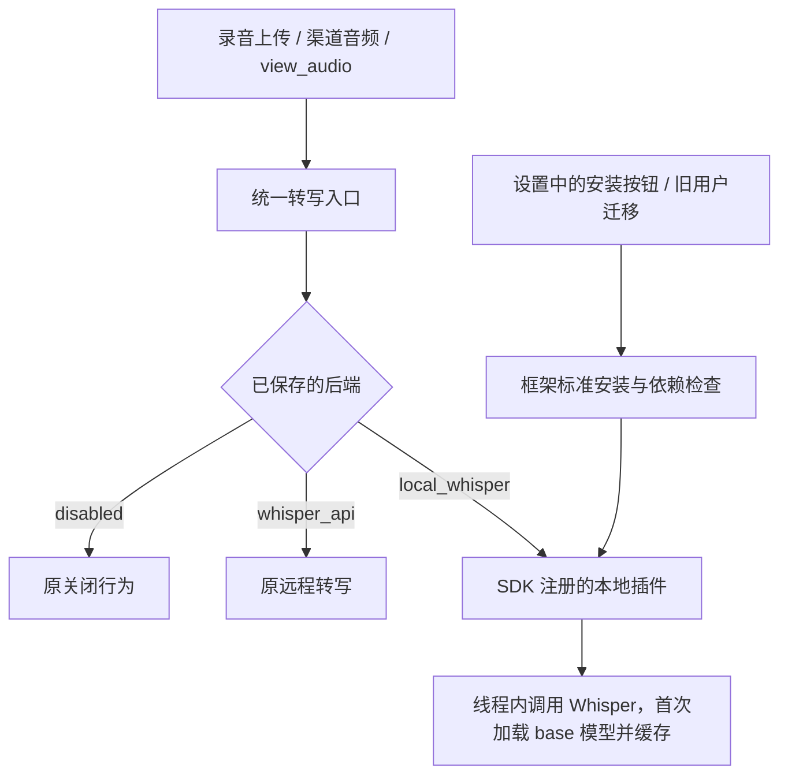

# 本地 Whisper 可选扩展

用户入口保持为 **设置 → 语音转写 → 本地 Whisper → 安装插件**。
安装调用框架标准插件流程，同时补齐缺少的 Python 依赖。不加入官方插件列表。
提供商选择只保存使用偏好，不负责安装、启用或停用插件。



## 安装与升级

- 新安装、未启用和远程用户：不下载、不导入 Whisper/PyTorch。状态查询仅检查包元数据和 ffmpeg 路径。
- 旧配置选中 `local_whisper`：后台执行一次迁移。已有依赖直接复用，否则受管理地补装；
  配置及现有模型缓存不变，迁移期间其他功能继续启动。失败保留配置并提供原因和重试。
- 安装不改变提供商选择；切换提供商也不改变插件的启用状态。启用、停用及卸载由插件框架处理。
- 停用会通过原插件生命周期释放模型引用；正在运行的线程未退出时明确报告忙碌。
  进程里已经导入的 PyTorch 需要重启后端才能彻底释放。
- ffmpeg 仍需用户或管理员提供。模型权重在首次转写时按 Whisper 原逻辑下载，不提前检查或下载。
- 桌面端通过随附 Python 将依赖安装到共享 `plugin_runtime` 目录，推理在后端进程内运行。
- 依赖安装使用框架公共流程：检查直接声明的版本要求及其与受保护宿主包的冲突，
  放行后由包管理器解析并安装依赖，完成后再次检查依赖是否满足插件要求。
- 单次安装子进程和等待安装锁的上限均为 1800 秒。同一插件的安装操作通过跨进程锁排队。
  安装失败或未取得锁时保留用户配置，设置页显示原因并提供重试入口。
- 关闭后端时由框架停止依赖安装或等待安装锁的任务，确认停止后释放锁并继续关机清理。
  安装被中断后可在设置页主动重试，已写入的共享依赖保留。

PyPI 手动安装：`pip install -U "qwenpaw[whisper]"`。
源码运行：`uv sync --extra whisper`，之后继续使用 `uv run --extra whisper qwenpaw app`；
严格依赖同步时应保留该 extra。`full` 已不包含 Whisper。
管理员管理的环境应由管理员安装 `openai-whisper` 及依赖；`QWENPAW_RUNTIME_PROVISIONER=local`
下程序不会自动修改管理员 Python。

迁移记录位于工作目录的 `plugin_runtime/migrations/local-whisper.json`。迁移尝试前先写入一次性标记；
中断或失败后需要用户主动重试，不在重启时自动恢复已卸载的插件。
插件通过框架安装到标准 `plugins/local-whisper` 目录，后续启动直接由框架发现。
发行内容中的源码仅作为安装来源，不参与自动加载。

状态页分别展示插件、openai-whisper 和 ffmpeg。只有框架已激活插件、转写能力已注册且
依赖齐全时才显示可用。卸载后即使 Python 依赖仍在，也显示未安装；重启保持卸载结果。
卸载不删除共享 Python 依赖、系统 ffmpeg 或已有模型缓存，遵循当前框架的清理范围。

## 桌面构建验证

`qwenpaw.spec` 不再收集 Whisper 模块、数据及元数据，并排除 torch 相关重模块。
实际包含的公共库保留版本元数据，避免安装器将宿主依赖误判为缺失；
`verify_optional_audio.py` 检查两个可执行文件的 Python 归档、重依赖文件和关键公共库元数据。
必须使用干净构建环境，检查最终产物和实际平台运行行为；代码或单元测试通过不能代替
Windows/macOS/Linux 安装包验收。离线且没有已有依赖时，小安装包无法保证升级后立即本地识别。
实际体积以构建测量为准。


## 音频转写（SDK 1.1）

manifest 声明 `"sdk": {"version": "1.1", "capabilities": ["transcription"]}`。
只导入公开 SDK 即可注册后端；ID 不得占用 `disabled`、`whisper_api`，重复 ID 会拒绝。

```python
from qwenpaw.plugins.transcription import (
    TranscriptionSpec, TranscriptionResult, TranscriptionStatus,
)

class Plugin:
    def register(self, context):
        context.register_transcription_backend(TranscriptionSpec(
            id="my-recognizer", label="My recognizer",
            transcribe=self.transcribe, status=self.status, timeout=120,
        ))

    def status(self, call):
        return TranscriptionStatus(True)

    def transcribe(self, call, file_path):
        call.check_cancelled()
        text = recognize(file_path)  # 作者的识别实现
        return TranscriptionResult(text=text, error="" if text else "empty")

plugin = Plugin()
```

`TranscriptionContext` 提供工作区、会话、日志、配置、存储、资源作用域、取消状态和截止时间。
同步回调在线程中执行；异步回调必须自行遵守取消和资源管理契约，不能创建未托管的线程。
结果区分正常文字、`empty`（没有识别到文字）、`unavailable`（缺少运行条件）、`failed`（执行失败）。
`status` 查询在插件激活后调用，不等于真正识别验收。不要在模块导入或 `register()` 时加载模型。

每次调用都计入原生命周期任务表。超时、取消时，同步识别线程结束前仍保留活动任务；
停用或升级会拒绝或报告尚未停止，而不会误报清理完成。注册返回的句柄可关闭，关闭后拒绝新调用。
`PluginTestHost.transcribe(id, path, workspace_id=..., session_id=...)` 和
`transcription_status(id)` 走相同的生产适配器，可用于作者测试。

第三方后端 ID 可通过 `transcription_provider_type` 配置或设置 API 选择；
不需要在核心增加供应商分支。本轮设置页面仍只展示原有选项。
本目录的 `main.py` 是使用这些公开接口的实际插件示例。
